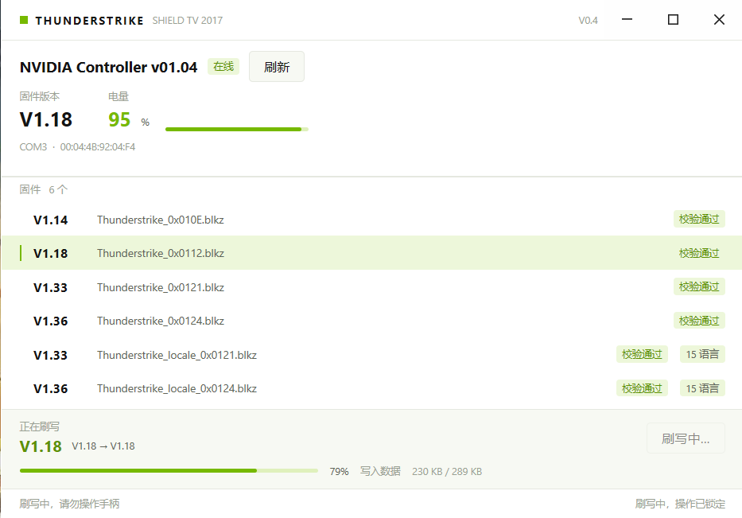
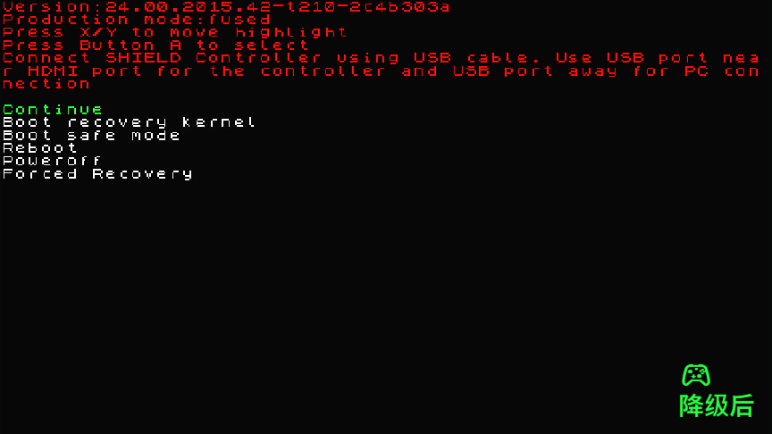
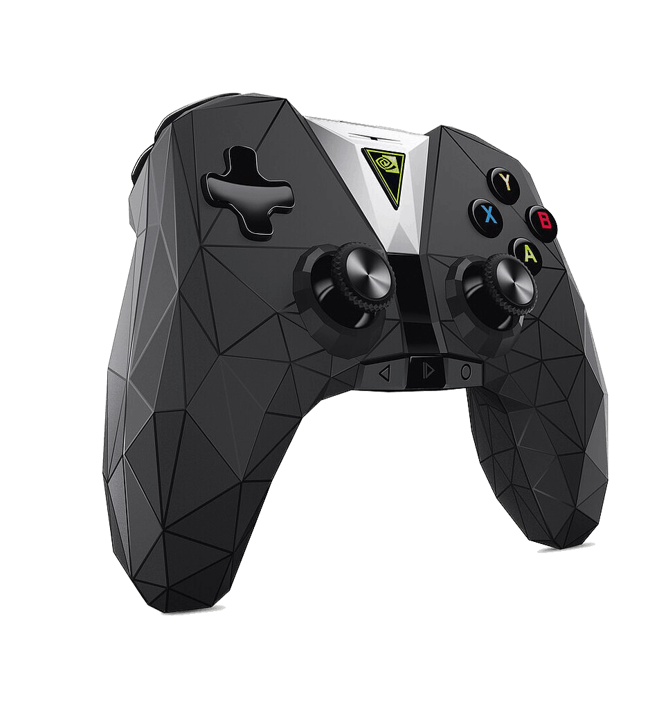

# Thunderstrike Controller Tool v0.4

    NVIDIA SHIELD TV 2017 Thunderstrike Controller Flash Tool - 手柄固件工具
    支持固件 降级 / 升级 / 平刷 · 设备信息读取
    仅支持 Windows · 仅通过蓝牙连接





## 快速开始

### 1. 下载

下载最新版本的 `Release\` 目录下的 `Release.zip` ，解压。

### 2. 准备固件

把 `.blkz` 固件包放到 `tsct.exe` 同目录的 `blkz/` 文件夹中。
程序自带了一些固件包，你也可以自己添加。

### 3. 连接手柄

电脑连接手柄蓝牙

### 4. 运行

双击 `tsct.exe` 启动，选择需要的固件即可可视化刷写固件了。


## 注意事项

⚠️ **刷写有风险，请注意：**
- 电池电量要充足（> 20%）
- 刷写过程中不要断开蓝牙
- 手柄休眠后会断开连接，刷写前请操作手柄保持唤醒
- 保留一份已知良好的固件包以备恢复

⚠️ **蓝牙连接说明：**
- 手柄需要先与电脑蓝牙配对
- 如果设备列表中没有手柄，请检查蓝牙配对状态
- 手柄休眠后可能需要按键唤醒才能重新发现


## 跳过 Android TV 激活

**系统要求**

    开发者版自带ROOT的ATV版本！

**解决 时间不同步**

    usb 链接电脑
    adb shell
    su
    看到 `darcy:/ $` 变为 `darcy:/ #` 即进入`root`状态
    修改ntp服务器地址为 `ntp.aliyun.com`
    settings put global ntp_server ntp.aliyun.com
    验证 ntp 服务器值
    settings get global captive_portal_http_url
    测试 ntp 服务器
    ping -c 2 connectivitycheck.platform.hicloud.com

**修改 Android TV 验证服务器**

    默认使用国外验证服务器,改为国内验证服务器

    小米
    settings put global captive_portal_http_url  http://connect.rom.miui.com/generate_204
    settings put global captive_portal_https_url https://connect.rom.miui.com/generate_204
    settings put global captive_portal_fallback_url  http://connect.rom.miui.com/generate_204

    或华为
    settings put global captive_portal_http_url  http://connectivitycheck.platform.hicloud.com/generate_204
    settings put global captive_portal_https_url https://connectivitycheck.platform.hicloud.com/generate_204
    settings put global captive_portal_fallback_url  http://connectivitycheck.platform.hicloud.com/generate_204
    
    Android 9 补充
    settings put global captive_portal_server connectivitycheck.platform.hicloud.com

**跳过向导**

    adb shell
    su
    settings put secure user_setup_complete 1
    settings put global device_provisioned 1

**禁用向导**

    adb shell
    su
    pm disable-user --user 0 com.google.android.tungsten.setupwraith
    
    // 最后重启系统
    reboot


## 固件版本

| 版本 | 说明 |
|------|------|
| V1.14 | 不能XY |
| V1.18 | 推荐版本 |
| V1.33 | 不能A+B |
| V1.36 | 不能A+B |

> 本工具不检查版本号，可以自由升降级，只要固件签名匹配即可刷写。
> 已实测验证：V1.33 → V1.18 降级成功。

## 固件包目录

固件包放在 `blkz/` 文件夹中，文件名格式：

```
blkz/
├── Thunderstrike_0x010E.blkz        # V1.14
├── Thunderstrike_0x0112.blkz        # V1.18
├── Thunderstrike_0x0124.blkz        # V1.36
└── Thunderstrike_locale_0x0124.blkz  # V1.36 多语言
```

## 技术栈

### 从源码编译

需要 Go 1.27.3+（界面库 MyGo 的最低要求，低于此版本会自动下载工具链）：

```powershell
go mod tidy
go build -o tsct.exe .
```

### 界面框架

界面使用 [MyGo](https://github.com/egoist/mygo) 原生自绘 UI（纯 Go、无需 cgo）：

| 库 | 说明 |
|---|---|
| [MyGo](https://github.com/egoist/mygo) | 原生窗口与自绘 UI 工具包（版本锁定 v0.7.1） |

### 核心依赖

| 库 | 说明 |
|---|---|
| [go.bug.st/serial](https://github.com/bugst/go-serial) | 串口通信（SPP 蓝牙串口） |
| [golang.org/x/sys](https://pkg.go.dev/golang.org/x/sys) | Windows 系统 API（HID、WMI） |


## 技术文档

技术实现细节和协议逆向分析见 [AIREADME.md](AIREADME.md)。

## 许可证

本项目仅供学习和研究使用。
NVIDIA、SHIELD、Thunderstrike 是 NVIDIA Corporation 的商标。

